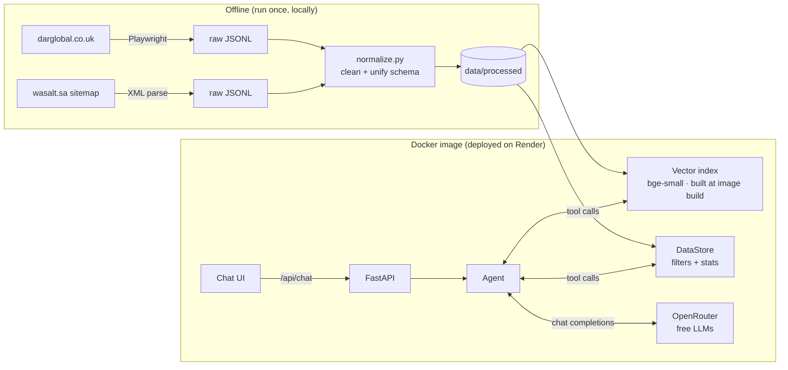

# Estate Assistant: real-estate AI chatbot (DarGlobal + Wasalt)

An AI chatbot that answers questions about **DarGlobal** luxury developments and the **Wasalt** Saudi property market. It uses data scraped from their public websites, a free LLM through **OpenRouter**, runs in **Docker**, and is deployed live.

| | |
|---|---|
| **Live chatbot** | **https://estate-assistant.onrender.com** |
| **Source code** | https://github.com/Praj460/estate-assistant |
| **MCP server** | `https://estate-assistant.onrender.com/mcp` (Streamable HTTP, read-only, no auth) |
| **LLM** | Free OpenRouter models (`nvidia/nemotron-3-ultra-550b-a55b:free` + fallbacks) |
| **Stack** | Python · Playwright · FastAPI · fastembed (ONNX) · NumPy · Docker · Render |

> The service runs on Render's free tier. If it has been idle, the first load can take ~30–50 s to wake up (a scheduled GitHub Action pings it every 10 minutes to prevent this).

---

## Try these questions

| Question | What it shows |
|---|---|
| Which DarGlobal projects are in Oman and when do they complete? | Structured filtering → table of 14 projects with completion dates |
| Show me villas with 4 or more bedrooms in Spain or Oman | Bedroom-range filtering across countries |
| Show me branded residences by luxury brands like Aston Martin or Missoni | Keyword + semantic search across projects and partner pages |
| What are the investment benefits of buying in Ras Al Khaimah? | Semantic search over long descriptions (Golden Visa, 0% tax, yields) |
| Who is DarGlobal and which brands do they partner with? | Company / investor / press pages |
| How many villas are for sale on Wasalt and what is the typical size? | Aggregate stats over 60,000 Wasalt listings |
| Compare rental apartments on Wasalt by number of bedrooms | Grouped market statistics |
| ما هي مشاريع دار جلوبال في السعودية؟ | Arabic question → Arabic answer |
| What is the price of a 3-bedroom apartment in DG1? | Honesty: DarGlobal doesn't publish prices → "price on request" (no hallucination) |

Every answer links back to the original source pages.

---

## MCP server (use the data from Claude, Cursor, or any MCP client)

The same tools the chatbot uses are also exposed as a **Model Context Protocol** server, so any MCP client can query the DarGlobal and Wasalt data with its own model. It uses no OpenRouter quota.

| Tool | Description |
|---|---|
| `dataset_overview` | What's in the dataset (projects per country, listing counts) |
| `search_listings` | Structured filters: country, city, type, bedrooms, price, area, keyword |
| `market_stats` | Counts, sizes and grouped shares across 60k Wasalt listings |
| `semantic_search` | Meaning-based search over descriptions and DarGlobal pages |
| `get_listing` | Full details of one project |

All tools are read-only and annotated as such.

**Remote (deployed):**

```bash
# Claude Code
claude mcp add --transport http estate-assistant https://estate-assistant.onrender.com/mcp
```

For Claude Desktop, Cursor and others, add a remote MCP server with the URL `https://estate-assistant.onrender.com/mcp`. Cloning this repo and opening it in Claude Code picks it up automatically via [`.mcp.json`](.mcp.json).

**Local (stdio), no network needed:**

```json
{ "mcpServers": { "estate-assistant": {
    "command": "/path/to/estate-assistant/.venv/bin/python",
    "args": ["-m", "app.mcp_server"],
    "cwd": "/path/to/estate-assistant" } } }
```

Implementation: [`app/mcp_server.py`](app/mcp_server.py), built with the official `mcp` Python SDK (v2). It's mounted inside the same FastAPI app (stateless Streamable HTTP with JSON responses) and shares the already-loaded data and vector index. DNS-rebinding protection only allows the deployment's own hostname.

---

## Data collected (snapshot: November 2026)

| Source | Content | Records |
|---|---|---|
| **DarGlobal** – projects | Title, country/city, type, bedroom range, size range (sqm/sqft), status, completion date, unit types, amenities, full description, image | **38 projects**, 6 countries (UAE, Oman, Saudi Arabia, Qatar, Spain, UK) |
| **DarGlobal** – pages | About, Why Invest, FAQ, Investor, Hospitality, 11 brand-partner pages, 15 press releases | **37 pages** |
| **Wasalt** – market | Every active sale/rent listing in Wasalt's public sitemap: property type, area, bedrooms, facing, street width | **60,000 listings** (45k sale, 15k rent) |
| **Wasalt** – detail | Full listing page: price, city, district, features, description | sample (see below) |

Processed data lives in [`data/processed/`](data/processed): `listings.jsonl`, `pages.jsonl` and `wasalt_market.jsonl`, all in one shared schema.

### How the data was collected (and the decisions behind it)

- **DarGlobal** is protected by Imperva. Plain HTTP requests get an empty JS-challenge page, so the site was scraped with **Playwright**: one ordinary browser session, 3–6 s between pages, images and fonts blocked, and only pages allowed by robots.txt. The `/projects` page embeds every project as Next.js JSON, which was used as the project index. Each project page was then parsed for its labelled fields (Property type, Status, Area, Unit type, Amenities) plus the full visible text.
- **Wasalt** is protected by Cloudflare. Listing URLs came from the **public sitemap linked in Wasalt's robots.txt**. Each URL encodes type, size, bedrooms, facing and street width (e.g. `villa-1050-sqm-facing-north-west-on-30m-width-street-5888671`), which gives a large, legitimate market dataset.
- **Wasalt detail pages:** a slow, visible-browser run was attempted (10–15 s per page). Cloudflare repeatedly asked for human verification, so detail scraping was **deliberately stopped** rather than bypassing the site's bot protection with stealth tooling. The detail parser is implemented ([`scraper/wasalt.py`](scraper/wasalt.py)) and validated on a sample listing (price, district, 20+ features).
- **Privacy:** no personal data is stored. Agent and owner names, phone numbers and licence-holder details present in Wasalt's page JSON are dropped at scrape time.
- **Data cleaning:**
  - Site-wide boilerplate (cookie banners, menus, buttons) is removed by frequency analysis.
  - URLs cannot contain ".", so "296.09 sqm" appears as `29609-sqm`. Residential units over 10,000 sqm are rescaled, which moved the median villa size from an implausible 25,109 sqm to a realistic 354 sqm.
  - Implausible bedroom counts (e.g. 43,000) are removed.

---

## Architecture



### Hybrid RAG with tool calling

Real-estate questions are a mix of **structured** ("4-bed villas in Oman", "how many apartments for rent") and **descriptive** ("investment benefits of RAK", "which projects are by Missoni"). Pure vector search handles numbers and filters poorly, so the LLM chooses among four tools:

| Tool | Purpose |
|---|---|
| `search_listings` | Structured filters: source, country, city, type, bedrooms, price, area, keyword, sorting |
| `market_stats` | Counts, size statistics and grouped shares over 60k Wasalt listings, pre-computed so the LLM doesn't do arithmetic |
| `semantic_search` | Vector search over 307 chunks of descriptions and DarGlobal pages |
| `get_listing` | Full details for one project or listing |

### Reliability on free infrastructure

- **Model fallback chain:** Nemotron Ultra, then Nemotron Super, then `openrouter/free`. Rate-limited or failing models are skipped automatically.
- **Empty-reply retry:** reasoning models sometimes spend their whole budget thinking and return nothing. The agent detects this and retries with the next model.
- **Tool-calling fallback:** if a model rejects the tool format, the agent falls back to classic retrieve-then-answer RAG.
- **Answer cache:** repeated first-turn questions (e.g. the suggested questions) are served from memory, saving free-tier quota.
- **Small footprint:** ONNX embeddings with no PyTorch. The image is about 460 MB and uses about 250 MB of RAM, so it fits free hosting tiers.

---

## Project structure

```
app/
  main.py          FastAPI app: /api/chat, /api/stats, /health, static UI, /mcp
  mcp_server.py    MCP server (same tools; Streamable HTTP + stdio)
  agent.py         OpenRouter agent: tool calling, fallbacks, cache
  data_store.py    structured search + market statistics
  retriever.py     chunking, embeddings, vector search (python -m app.retriever builds the index)
  static/index.html  chat UI (markdown, source chips, dark mode, mobile-friendly)
scraper/
  common.py        polite single-session Playwright browser
  darglobal.py     DarGlobal projects + info/press pages
  wasalt_sitemap.py  Wasalt market dataset from the public sitemap
  wasalt.py        Wasalt listing-detail scraper (sample, see notes)
  normalize.py     cleaning + unified schema -> data/processed/
data/processed/    final datasets shipped in the image
Dockerfile, render.yaml, .github/workflows/keep-awake.yml
```

---

## Run it yourself

**With Docker:**

```bash
git clone https://github.com/Praj460/estate-assistant && cd estate-assistant
cp .env.example .env              # add your free OPENROUTER_API_KEY
docker build -t estate-assistant .
docker run -p 7860:7860 --env-file .env estate-assistant
# open http://localhost:7860
```

**Re-scrape the data (optional):**

```bash
pip install -r requirements-scrape.txt && playwright install chromium
python -m scraper.darglobal        # ~8 min, polite pacing
python -m scraper.wasalt_sitemap   # ~10 s
python -m scraper.normalize
```

## Deployment

Deployed on **Render** (free Docker web service) from this repo via [`render.yaml`](render.yaml). `OPENROUTER_API_KEY` is stored as a private environment variable in Render, and every push to `main` redeploys automatically.

## Limitations and next steps

- DarGlobal doesn't publish prices, so the bot answers "price on request".
- Wasalt market data has no prices or cities, because detail pages are Cloudflare-protected (see above). With an official data feed or API, the existing detail parser would add prices and locations.
- Free LLMs are rate-limited and vary in quality. The fallback chain mitigates this, but occasional "try again" messages are possible.
- **Next steps:** a scheduled re-scrape (GitHub Actions), streaming responses, and an evaluation set of Q&A pairs for regression testing.
